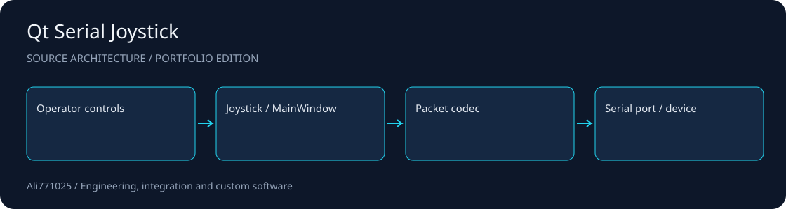

# Qt Serial Joystick

<!-- project-contact:start -->
**Work with Yosof Omrani:** [Email a project inquiry](mailto:aliomrani916@gmail.com) · **aliomrani916@gmail.com** · [Services & contact](https://ali771025.github.io/software-portfolio/en/contact/) · [Portfolio walkthrough](https://ali771025.github.io/software-portfolio/en/work/qt-serial-joystick/)
<!-- project-contact:end -->

**A desktop control panel with a custom joystick, explicit packet framing and serial feedback.**

Qt Widgets · C++ · Serial device integration

[راهنمای فارسی](docs/README.fa.md) · [Architecture](docs/ARCHITECTURE.md) · [Discuss a project](https://github.com/Ali771025)

## What this demonstrates

- Custom joystick with bounded motion, centering and synchronized numerical inputs.
- Velocity and position modes, configurable send intervals and serial device discovery.
- Explicit 33-byte little-endian framing, XOR integrity check and feedback parsing.

## Source map

| Path | Responsibility |
| --- | --- |
| `mainwindow.cpp` | UI and operating modes |
| `joystickwidget.cpp` | Custom joystick widget |
| `protocol.cpp` | Packet codec |
| `serialmaster.cpp` | Serial I/O |

## Setup and integration

Open `JoystickMaster.pro` in Qt Creator with Qt Widgets and Qt Serial Port installed. The original source targets a Qt 5 / MinGW desktop toolchain. Build with a compatible kit, then configure the COM port, baud rate and device identifier for your hardware. Read `protocol.txt`, `protocol.cpp` and `serialmaster.cpp` before integration.

## Scope and evidence

No executable, device identifiers or client configuration is bundled. Timing depends on the desktop OS. Stop closes transmission; it is not a hardware emergency stop. Hardware behavior and packet compatibility must be accepted on the target device.

This public portfolio edition contains selected source and integration manifests. Contracts, private data, customer materials, original Git history, dependency trees and large assets are excluded. No tests, builds or application runs were performed for this publication; no previous result is presented as a current validation.

## Work with me

I am available for projects involving Qt Widgets, C++, Serial device integration. For a useful first discussion, share the problem, target environment, expected deliverables and acceptance criteria. I can help scope an implementation, integration or improvement around your constraints.

Contact: [Ali771025 on GitHub](https://github.com/Ali771025). Please share confidential material through an agreed private channel.

## Rights and dependencies

Publication for portfolio review does not grant a new blanket license. Existing file notices and dependency terms continue to apply. Contact the author to agree terms for reuse or a commercial engagement.
