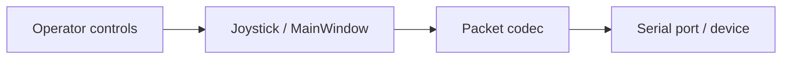

# Qt Serial Joystick architecture

The diagram describes the source responsibilities, not a measured production deployment.

| Module | Responsibility |
| --- | --- |
| `mainwindow.cpp` | UI and operating modes |
| `joystickwidget.cpp` | Custom joystick widget |
| `protocol.cpp` | Packet codec |
| `serialmaster.cpp` | Serial I/O |

No executable, device identifiers or client configuration is bundled. Timing depends on the desktop OS. Stop closes transmission; it is not a hardware emergency stop. Hardware behavior and packet compatibility must be accepted on the target device.
